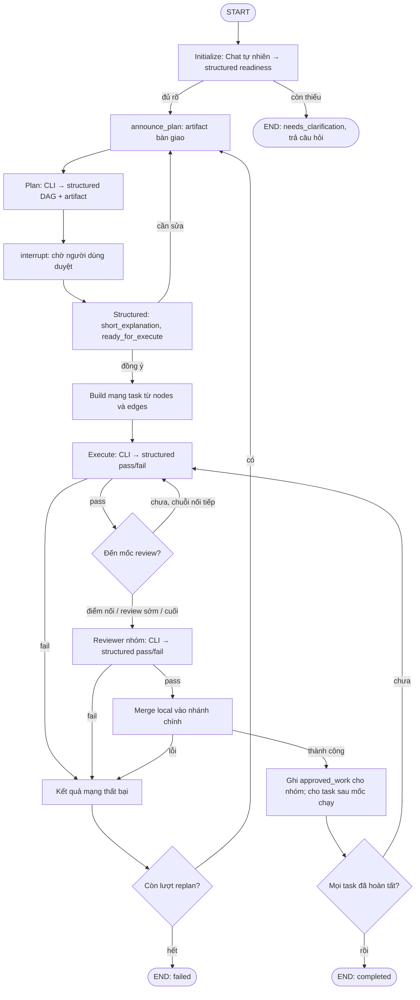

# Coding Agent Orchestrator

LangGraph bắt đầu bằng Initialize làm rõ yêu cầu, sau đó điều phối Plan, Execute
và Reviewer. Ba role coding dùng chung chu trình:
**coding CLI → báo cáo tự nhiên → ChatOpenAI structured output**.

## Chạy mặc định: một container, cổng 2026

```bash
docker compose up --build -d
```

Container `team` có đủ LangGraph dev, Qwen Code CLI, OpenCode CLI và GitLab CLI (`glab`). API ở
http://localhost:2026, docs ở http://localhost:2026/docs. Các CLI chạy trực tiếp
trong cùng container, yolo, mỗi task có Git worktree/nhánh riêng, mỗi lần gọi CLI có scratch workdir tự dọn; không cần Docker
socket hoặc container con. Compose đọc khóa/model từ .env và override đường dẫn
workspace/CA theo container. CA bundle mount read-only, không copy vào image.

Workspace mặc định là thư mục dự án hiện tại. Đặt PROJECT_WORKSPACE trong .env
nếu muốn sửa repository khác. Dữ liệu LangGraph được giữ trong volume team-state;
source code mount vào /app để hot reload. Xem log bằng `docker compose logs -f team`.
Dừng bằng `docker compose down` (giữ dữ liệu). File chứng chỉ cần có sẵn ở
.local/certs/ca-bundle.pem. UID/GID mặc định 1000, có thể đổi CODER_UID/CODER_GID.

Các hướng dẫn chạy host bên dưới là lựa chọn thay thế, không cần cho Compose.

```text
graph.py                         # Graph điều phối và entrypoint graph/build_graph
orchestrator/
  schemas.py                     # PlanGraph, task và Assessment pass/fail
  state.py                       # State của phase, agent và workflow
  agents/
    initialize.py                # Chat tự nhiên → structured readiness gate
    plan.py                      # Khám phá code → kế hoạch DAG
    execute.py                   # Triển khai → đánh giá báo cáo
    reviewer.py                  # Kiểm tra code/test → đánh giá review
    assessed.py                  # Adapter task/báo cáo chung Execute và Reviewer
  runtime/
    responses.py                 # ChatOpenAI diễn đạt phản hồi theo lịch sử người dùng
    cli.py                       # Chạy OpenCode/Qwen với LLM nội bộ
    two_phase.py                 # Graph dùng chung prepare → coding → structure
    network.py                   # Build DAG, Execute → Reviewer → merge, tái sử dụng việc đã duyệt
    git_tasks.py                 # Checkout theo task, khóa review/merge Git local
    artifacts.py                 # Artifact bàn giao/DAG và lọc khỏi đầu vào model
    status.py                    # AIMessage tiến độ được cập nhật theo ID
    cli_logs.py                  # Log trực tiếp, che token và giữ stdout/stderr
    thinking.py                  # Thinking global và override từng role
  terminal_monitor.py            # Custom HTTP app /terminals dùng chung cổng LangGraph
config/                          # Prompt và cấu hình YAML cho từng role
examples/                        # Ví dụ chạy workflow/Execute
tests/                          # Unit và integration test offline
```

Các file `plan_agent.py`, `execute_agent.py`, `reviewer_agent.py`, `llm_cli.py` ở
root chỉ giữ import tương thích. Code mới dùng package `orchestrator` và entrypoint
`graph.py`. `plan_agent.build_plan_agent` cũ vẫn trả toàn workflow;
`orchestrator.agents.plan.build_plan_agent` chỉ trả graph Plan hai bước.

## Chạy

```bash
pip install -r requirements.txt
python -m examples.run_plan 'Thêm API health và test'
python -m examples.run_plan 'Thêm API health và test' --plan-only
```

Hai CLI được cài trong image Docker, không cần cài trên host. Copy `.env.example` sang `.env` rồi cấu hình
`QWEN_BASE_URL`, `QWEN_MODEL`, `QWEN_API_KEY`. ChatOpenAI ưu tiên `DECISION_*`,
fallback sang `QWEN_*`. Endpoint phải gồm API prefix, thường `/v1`.

Image cũng có GitLab CLI (`glab`). Điền `GITLAB_TOKEN` trong `.env` và
`GITLAB_HOST` nếu dùng GitLab riêng; Compose tự nạp khi khởi động container,
không cần chạy `glab auth login`. Có thể pin tag image glab bằng `GLAB_VERSION`.
Sau khi thay đổi, chạy `docker compose up -d --build team`; kiểm tra bằng
`docker compose exec team glab --version`.

```python
import asyncio
from dotenv import load_dotenv
from langchain_core.messages import HumanMessage
from graph import build_graph

async def main():
    load_dotenv()
    workflow = build_graph()
    result = await workflow.ainvoke({
        "messages": [HumanMessage(content="Thêm API health và test")],
    }, config={"max_concurrency": 3})
    print(result["status"], result["messages"][-1].content)

asyncio.run(main())
```

`graph.py` cũng export biến `graph` đã compile cho LangGraph. Import module chỉ
build cấu trúc, không gọi CLI/API. Caller tự load môi trường trước khi invoke.

## Luồng thực thi



Task độc lập chạy song song trên các Git worktree riêng. Chuỗi nối tiếp chỉ
review ở cuối; trước điểm nối nhiều nhánh, runtime đợi các nhánh cần thiết rồi
review chung. Phần còn lại được review cuối kế hoạch. `review_after: true`
trong node Plan đặt mốc review sớm cho task rủi ro cao hoặc đổi hợp đồng chung.
Mỗi task thuộc một nhóm review; shared ancestor được gán cho một mốc để tránh
review/merge trùng. Mốc khác cần ancestor đó sẽ chờ nhóm sở hữu được duyệt.

Execute pass tạo trạng thái tạm `executed`; task sau trong chuỗi kế thừa commit
của dependency trên worktree riêng, không cần merge nhánh đích ngay. Reviewer
kiểm tra bản tích hợp của cả nhóm với nhánh đích mới nhất. Chỉ nhóm được duyệt
mới merge và chuyển các task sang `completed`. Review fail làm cả nhóm chưa
hoàn tất; task phụ thuộc bị skip. Các nhóm đã duyệt vẫn giữ trong approved_work.
Scheduler chỉ chờ dependency liên quan, không chờ nhánh độc lập chậm tại mốc nối.
Review/merge Git được tuần tự hóa. Mặc định có hai lượt technical replan sau
lần đầu (`config/plan.yaml: max_replans`).

Plan hiển thị thông báo tiến độ bằng code, giữ báo cáo CLI trong state/log và
chỉ phát một thông báo kết quả kèm artifact DAG đã validate. Sau đó graph dừng
ở `interrupt()` chờ người dùng duyệt. Phản hồi được đánh giá bằng
`short_explanation`, `ready_for_execute`: false quay lại Plan cùng góp ý và kế
hoạch trước; true mới chạy Execute. Trước lần chấp nhận đầu tiên, mỗi bản sửa
theo góp ý đều hỏi duyệt lại và không tiêu hao `max_replans`. Sau khi đã chấp
nhận, các replan do lỗi Execute/Reviewer/tích hợp tự chạy trong phạm vi đã duyệt
và giới hạn `max_replans`, không hỏi lại. Hoàn thành hoặc hết lượt thì tổng kết
và END; không tự mở thêm vòng làm việc.

Chạy Python trực tiếp cần checkpointer và cùng `thread_id` để resume:

```python
from langgraph.checkpoint.memory import InMemorySaver
from langgraph.types import Command

workflow = build_graph(checkpointer=InMemorySaver())
config = {"configurable": {"thread_id": "my-task"}}
result = await workflow.ainvoke({"messages": [("user", "Thêm API health")]}, config)
# Khi result có __interrupt__, hiển thị câu hỏi và kế hoạch rồi chờ người dùng.
result = await workflow.ainvoke(Command(resume="Đồng ý thực thi"), config)
# Nếu góp ý sửa, result lại có __interrupt__ để duyệt kế hoạch mới.
```

LangGraph Server quản lý checkpoint/thread cho graph mặc định. Caller/UI cần
resume interrupt hiện tại thay vì gửi một lượt input mới từ START. Với
`dispatch_execute=False`, graph chỉ tạo kế hoạch và kết thúc, không hỏi duyệt.
Prompt đánh giá ở `config/plan_approval.yaml`. Plan có một lượt CLI và một lần
structured DAG; mỗi phản hồi duyệt thêm một lần structured approval.

Kiểm tra offline:

```bash
.venv/bin/python -m unittest discover -s tests -v
```

Xem [chi tiết cấu hình và giới hạn](docs/plan-execute.md).

Initialize hỏi làm rõ hoặc xác nhận yêu cầu trong `messages`. Structured output
gồm `short_explanation` rồi `ready_for_plan`; nếu chưa rõ thì dừng với
`needs_clarification`. Câu trả lời Initialize hiển thị trực tiếp, không gọi
model viết lại; mỗi lượt bình thường chỉ có hai lần gọi LLM.
Caller nối câu trả lời của user vào messages nhận được rồi invoke lại (hoặc
sử dụng lịch sử thread của môi trường LangGraph).

Không cần truyền workspace: dùng `WORKSPACE_ROOT` từ môi trường, fallback thư
mục làm việc hiện tại. Giá trị workspace tường minh vẫn được chấp nhận để tương
thích. Mọi báo cáo tự nhiên tạo AIMessage mới. Bước structured được tag
`no_stream` và tắt streaming model; riêng Plan trả thêm artifact sau khi DAG
được validate thành công. UI khi stream messages cần lọc event
có tag `no_stream`. Prompt Initialize ở `config/initialize.yaml`.

Thông báo tiến độ theo mốc bắt đầu/kết thúc, không dùng timer. Mỗi role có node
announce_start/announce_result và cập nhật ngay khi CLI kết thúc; các mốc có
liên kết `/terminals`. Root có announce_plan/announce_execution/summarize_execution.
Message tiến độ cùng ID được thay thế thay vì append. Để xem ngay khi node trả
kết quả: `python -m examples.stream_progress 'Thêm API health và test'`, hoặc dùng
`astream(..., stream_mode="updates", subgraphs=True)` và upsert theo message.id.

Coding CLI luôn tự chấp thuận (Qwen --yolo, OpenCode permission=allow). Mỗi task
Execute có nhánh/worktree riêng; Reviewer dùng checkout khác chứa bản merge thử.
Mỗi lần gọi CLI còn có scratch cwd tạm với `project/` trỏ tới checkout được giao;
scratch tự dọn sau khi chạy. `AGENT_WORKDIR_ROOT` chọn nơi đặt scratch.

## Checkout riêng và merge Git local

Mặc định `GIT_TASK_ISOLATION=true`, `GIT_TARGET_BRANCH=main`. Workspace phải là
Git repository đã có commit, đang checkout đúng nhánh đích và sạch (kể cả file
untracked chưa ignore). Commit hoặc stash thay đổi hiện có trước khi chạy.
Nếu nhánh chính tên khác, đặt `GIT_TARGET_BRANCH` tương ứng; runtime không tự
chuyển nhánh hoặc bỏ thay đổi có sẵn.

Executor sửa trên nhánh `orchestrator/task-...`; runtime commit kết quả khi
Execute pass. Các lượt tích hợp dùng khóa chung của repository: tạo bản merge
thử từ nhánh chính mới nhất, gọi Reviewer kiểm tra code/test, rồi chỉ fast-forward
nhánh chính khi Reviewer pass. Không push remote, tạo MR hay gọi GitLab API.
Task phụ thuộc được tạo checkout sau khi các task trước đã merge thành công.

Conflict, review fail hoặc checkout lỗi khiến task failed và descendants skipped;
Plan nhận metadata `integration` để lập việc phục hồi. Main chỉ chứa công việc đã
merge. Worktree thành công được dọn; nhánh Git được giữ. Worktree lỗi giữ lại
để điều tra, mặc định tại `/tmp/orchestrator-worktrees`; chọn `GIT_WORKTREE_ROOT`
và mount thư mục đó nếu cần giữ checkout qua việc tạo lại container. Thư mục
`/tmp` của container không phải nơi lưu lâu dài; commit/nhánh nằm trong Git repo.

`GIT_TASK_ISOLATION=false` bật lại chế độ sửa chung workspace cũ. Khi bật isolation,
`completed` của task nghĩa là đã được Reviewer duyệt **và merge local**. Reviewer
kiểm tra tác động tích hợp trên từng bản merge; chưa có lượt kiểm thử toàn repo
riêng sau khi mọi task kết thúc. Worktree tách file code, không phải OS sandbox.

## LangGraph dev trên host

```bash
.venv/bin/python scripts/dev.py --host 127.0.0.1 --port 2024
```

Cấu hình `langgraph.json` nạp graph `team` từ `graph.py:graph`. Launcher đọc .env,
chuẩn hóa SSL_CERT_FILE và NODE_EXTRA_CA_CERTS thành đường dẫn tuyệt đối (mặc định
.local/certs/ca-bundle.pem), rồi exec langgraph dev. Không cần mount khi chạy host;
các coding CLI tự kế thừa CA bundle qua môi trường, kể cả khi cwd là thư mục tạm.
WORKSPACE_ROOT phải là thư mục host có thật, không dùng đường dẫn /workspace của
container cũ. Khi CODING_CLI_RUNTIME=docker, host chỉ cần Docker; hai CLI nằm trong image.

API: http://127.0.0.1:2024 — Docs: http://127.0.0.1:2024/docs.
Nếu cần cài môi trường mới: `pip install -e ".[dev]"`.

## Tùy chọn khác: Coding CLI chạy Docker, LangGraph dev chạy host

```bash
docker build --target cli --network host --secret id=ca_bundle,src=.local/certs/ca-bundle.pem -t coding-agent-cli:local .
.venv/bin/python scripts/dev.py
```

.env dùng CODING_CLI_RUNTIME=docker và CODING_CLI_IMAGE=coding-agent-cli:local.
Mỗi invocation tạo container --rm riêng, chạy yolo, mount workspace và scratch
vào cùng đường dẫn tuyệt đối, mount CA bundle read-only và chuyển hai biến
SSL_CERT_FILE/NODE_EXTRA_CA_CERTS. Timeout sẽ xóa container trước khi dọn workdir.
API key chỉ truyền qua môi trường. Container dùng network host để truy cập LLM
nội bộ/localhost trên Linux; không mount Docker socket vào coding container.
User coder trong image mặc định UID/GID 1000; đổi build args CODER_UID/CODER_GID
nếu user host khác. QWEN_CODE_VERSION và OPENCODE_VERSION cho phép pin bản CLI.

## Thinking / reasoning

Mặc định tắt cho ChatOpenAI và cả hai coding CLI:

```dotenv
LLM_THINKING=false
LLM_THINKING_FORMAT=chat_template_kwargs
```

Từng YAML có thể ghi đè:

```yaml
thinking: true          # true/false; null kế thừa .env
thinking_format: null  # kế thừa global
```

ChatOpenAI nhận `extra_body={"chat_template_kwargs": {"enable_thinking": false}}`;
Qwen nhận extra_body trong generationConfig; OpenCode nhận options của model.
Server yêu cầu cờ ở cấp ngoài có thể chọn `thinking_format: enable_thinking`.
Server/model cần hỗ trợ cờ tương ứng.

Thay .env cần tạo lại container: `docker compose up -d --force-recreate`.

## Xem log CLI trực tiếp

Mở `/terminals` trên server LangGraph (Compose: `http://localhost:2026/terminals`,
local dev: `http://localhost:2024/terminals`). Cả hai cấu hình LangGraph gắn cùng
HTTP app. Đặt `CLI_LOG_DIR=.local/cli-logs` trong `.env` để bật ghi log Qwen và
OpenCode theo từng lần chạy, kể cả runtime Docker. Bỏ biến này để tắt ghi log.
Terminal xuất hiện ngay khi bắt đầu chạy, mang tên nhiệm vụ (ví dụ
`Execute · Sửa đăng nhập`) thay cho UUID `.log`, kèm vai trò, mã task, thời gian
và trạng thái. Danh sách ưu tiên phiên đang chạy; viewer cập nhật mỗi 500 ms,
tự mở phiên mới khi đang chờ. Chọn một phiên cụ thể sẽ giữ nguyên lựa chọn đó.
Tiêu đề lấy từ instructions của task; Plan dùng yêu cầu gần nhất của người dùng,
không gọi thêm model để đặt tên. Các phiên cũ không có metadata hiện tên lịch sử.

Qwen dùng `stream-json` cùng `--include-partial-messages`; OpenCode dùng
`run --format json`. Viewer hiển thị phần phản hồi/tool ngay khi CLI phát sự kiện,
không chờ toàn bộ lệnh hoàn tất. OpenCode phát text khi xong từng phần phản hồi,
tool khi xong từng thao tác; khoảng chờ API/tool chưa phát sự kiện sẽ chưa có
nội dung mới. Log giữ ngoài workdir tạm, gồm sự kiện đã chuyển thành văn bản và
stderr; agent nhận báo cáo văn bản đã tách khỏi JSON giao thức.
Các giá trị token/API key trong môi trường được che trong log. Log không tự xóa;
có thể xóa file cũ cùng sidecar `.log.json` trong thư mục này khi không cần. Viewer chỉ đọc log và không
thêm cơ chế đăng nhập riêng. Không cần mở thêm cổng hoặc chạy server phụ.

## Artifact kế hoạch và bàn giao

Plan tạo thêm một AIMessage chỉ đọc sau khi structured DAG được validate: sơ đồ
Mermaid cùng bảng nhiệm vụ, phụ thuộc và tiêu chí hoàn thành. Artifact được dựng
bằng code, không gọi thêm model. Client hỗ trợ Mermaid sẽ hiển thị sơ đồ; bảng
Markdown vẫn đọc được trên client khác. Metadata nằm ở
`additional_kwargs.orchestrator_artifacts` (`type=execution_plan`) chứa payload
được ghép vào sau lời tóm tắt do AI viết. Artifact-only dùng khóa cũ
`orchestrator_artifact`.
`orchestrator.runtime.artifacts.preprocess_messages()` lọc phần artifact khỏi
đầu vào Initialize/Plan/Execute/Reviewer, kể cả replan; lịch sử chat và `state.plan`
vẫn giữ nguyên. Khi thêm agent mới nhận lịch sử, gọi hàm này trước khi tạo prompt.

Trước mỗi lần bàn giao sang Plan (kể cả replan), node `announce_plan` phát
AIMessage artifact `plan_handoff` với ID `plan-handoff:<attempt>:<uuid>`,
thể hiện các bước tiếp theo và liên kết `/terminals`. Artifact này cũng được
`preprocess_messages()` loại khỏi đầu vào agent/model, giữ nguyên lịch sử hiển thị.


## Skills riêng cho từng CLI

Chọn skills Qwen ở `config/cli/qwen.yaml`, OpenCode ở
`config/cli/opencode.yaml`. Cả hai đã cấu hình skills riêng theo role. `paths` là skills chung; `roles` chỉ
nạp thêm skills của agent đang chạy. Ví dụ:

```yaml
skills:
  enabled: true
  paths: []
  roles:
    plan:
      - ../../skills/plan
    execute:
      - ../../skills/execute
      - ../../skills/vendor/ponytail/ponytail
    reviewer:
      - ../../skills/reviewer
```

Mỗi path có thể là một skill chứa `SKILL.md` hoặc thư mục có các skill con trực
tiếp `<name>/SKILL.md`. Đường dẫn tương đối tính từ file YAML, không phải workspace
hay checkout của Executor. Hai file CLI có thể chọn nguồn skills khác nhau.
Có thể chọn cùng skill trong cả hai config.

Runtime copy skill và scripts/assets vào `.qwen/skills` hoặc `.opencode/skills`
của scratch workdir, không sửa repository đích hoặc đưa toàn bộ skill vào prompt.
Skill được CLI nạp theo cơ chế native. Cả local và Docker dùng cùng cấu hình;
không cần mount thêm skill vào container con. Trong Compose, đường dẫn nguồn phải
truy cập được từ container team (source dự án đang mount ở `/app`).

Override file bằng `QWEN_SKILLS_CONFIG` / `OPENCODE_SKILLS_CONFIG` trong `.env`.
`enabled: false` chỉ tắt việc stage skills từ config này; không tắt các skill global
hoặc bundled mà CLI tự nạp. Xem thêm hợp đồng trong [tài liệu kỹ thuật](docs/plan-execute.md#skills-config-riêng-theo-cli).


## Log tiến độ từng bước

Runtime mặc định log INFO khi bắt đầu/kết thúc từng node xử lý, LLM/CLI và các
bước Git checkout/review/merge. Xem bằng `docker compose logs -f team` hoặc stderr
khi chạy host. Khi đã đặt `CLI_LOG_DIR`, runtime cũng ghi `orchestrator.log` vào
thư mục đó; mở `/terminals` rồi chọn file này để theo dõi toàn workflow.

Mỗi log có event, agent/node, task ID, thread ID nếu được cung cấp và node run ID
để phân biệt các task chạy song song. LLM log ghi mục đích hội thoại/structured,
model, endpoint origin, schema, thời gian chạy và kết quả; hội thoại có thêm usage
nếu provider trả token usage. CLI log có runtime, model, độ dài prompt/output,
exit code và đường dẫn log terminal. Không ghi toàn bộ prompt/report hoặc API key;
lỗi ghi loại exception. Nội dung stdout/stderr CLI chi tiết vẫn ở file riêng.

`ORCHESTRATOR_LOG_LEVEL=INFO` là mặc định; dùng `WARNING`/`ERROR` để giảm log.
Có thể đặt `ORCHESTRATOR_LOG_FILE` để đổi file runtime. File log không tự rotate
hoặc xóa; `.local/` đã được Git ignore.

Logging dùng hàng đợi với worker ghi stderr/file; node async khởi tạo cấu hình
log/model và chạy thao tác Git/filesystem đồng bộ trong thread để tương thích
blocking detector của LangGraph dev. Không cần bật tùy chọn cho phép blocking.


Skills đã cài và bật theo role:

| Role | Skills |
| --- | --- |
| Plan | repository-discovery, dependency-planning, replan-recovery |
| Execute | scoped-implementation, systematic-debugging, verification-before-completion, ponytail |
| Reviewer | evidence-based-review, integration-regression, verification-before-completion |

Sáu skills đặc thù nằm dưới `skills/plan`, `skills/execute`, `skills/reviewer`.
Ponytail tải từ [DietrichGebert/ponytail](https://github.com/DietrichGebert/ponytail),
hai skills Superpowers từ [obra/superpowers](https://github.com/obra/superpowers).
Bản vendored có license, commit/hash nguồn và ghi chú điều chỉnh ở
`skills/sources.json`. Skills đã được giới hạn theo task: runtime vẫn quản lý
commit/merge và dispatch, không tự chạy vòng chờ hỏi đáp trong CLI.

Bộ [LangGraph offline](skills/vendor/langchain-skills/README.md) lưu toàn bộ
7 skill `langgraph-*` từ `langchain-ai/langchain-skills`, kèm 2 skill nền,
references và bản Markdown của quickstart Python/TypeScript. Commit nguồn,
license và checksum nằm cùng snapshot; đọc trực tiếp khi không có mạng hoặc
chọn skill cần thiết qua YAML CLI theo role.

Role được truyền tự động từ agent vào runner; đổi `cli` trong YAML role vẫn giữ
đúng lựa chọn skills cho backend đó. Initialize chỉ dùng ChatOpenAI nên không
nạp CLI skills. Khi gọi runner trực tiếp, truyền `role="execute"`/`"plan"`/`"reviewer"`;
nếu bỏ role thì chỉ nạp `paths` chung. Skills có hiệu lực ở invocation CLI tiếp
theo, không cần cài global; source phải có trong container hoặc mount `/app`.


## Phản hồi dễ hiểu theo người đang hội thoại

Initialize, Plan, Execute và Reviewer không dùng LLM viết lại thông báo.
Execute/Reviewer hiển thị tiến độ bằng code và trạng thái cùng explanation từ
assessment. Báo cáo CLI giữ trong state/log, không đưa nguyên báo cáo vào chat.
Mỗi role Execute/Reviewer có một lượt CLI và một lần ChatOpenAI structured
pass/fail. Execute pass chỉ cho phép chuyển Reviewer; Reviewer pass chưa xác
nhận đã merge. Thông báo Git chỉ được phát sau kết quả tích hợp thực tế.
Các graph task/network và execute_network không viết lại thông báo con.
Thông báo team bắt đầu thực thi cũng được tạo bằng code. Thông báo tổng kết
và chuẩn bị technical replan của team vẫn dùng lớp diễn đạt ChatOpenAI.
Prompt và giới
hạn nằm ở `config/response.yaml`; dùng DECISION_* và fallback QWEN_* như các
bước ChatOpenAI khác. Model chọn ngôn ngữ/mức độ kỹ thuật theo hội thoại, giải thích
lỗi/blocker và việc cần tiếp theo; không thay quyết định thực thi/review/merge.
Mỗi message chưa xử lý thêm một lần gọi model; message từ subgraph đã viết lại
không gọi lại khi chuyển lên graph cha.

Báo cáo kỹ thuật gốc vẫn ở output/natural_plan/assessment/results để các agent
đánh giá. Nội dung chat là bản diễn đạt; các ID tiến độ được giữ để UI upsert.
Artifact Mermaid/bảng được code tạo rồi ghép sau phần lời; model không viết lại
artifact. Preprocessing giữ lời tự nhiên và bỏ toàn bộ payload artifact trước
mọi lần gọi agent/model, kể cả model viết phản hồi.

Xem log `purpose=user_response`. Token trung gian của cả báo cáo và bước viết lại
được gắn no_stream; UI đọc AIMessage hoàn chỉnh qua updates. Nếu model diễn đạt
lỗi/timeout, runtime ghi response_error và không phát báo cáo thô/thông báo mẫu
thay thế; trạng thái nghiệp vụ và merge đã thực hiện được giữ, artifact vẫn còn.
