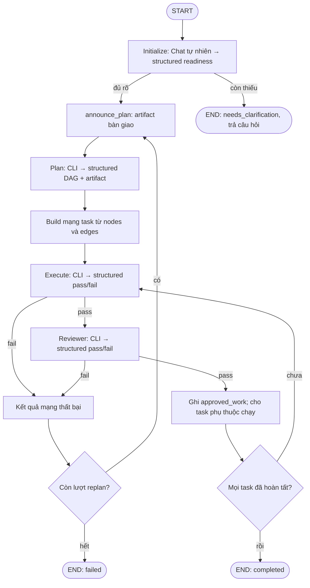

# Coding Agent Orchestrator

LangGraph bắt đầu bằng Initialize làm rõ yêu cầu, sau đó điều phối Plan, Execute
và Reviewer. Ba role coding dùng chung chu trình:
**coding CLI → báo cáo tự nhiên → ChatOpenAI structured output**.

## Chạy mặc định: một container, cổng 2026

```bash
docker compose up --build -d
```

Container `team` có đủ LangGraph dev, Qwen Code CLI, OpenCode CLI và GitLab CLI (`glab`). API ở
http://localhost:2026, docs ở http://localhost:2026/docs. Các CLI chạy trực tiếp
trong cùng container, yolo, mỗi lần có workdir tạm riêng tự dọn; không cần Docker
socket hoặc container con. Compose đọc khóa/model từ .env và override đường dẫn
workspace/CA theo container. CA bundle mount read-only, không copy vào image.

Workspace mặc định là thư mục dự án hiện tại. Đặt PROJECT_WORKSPACE trong .env
nếu muốn sửa repository khác. Dữ liệu LangGraph được giữ trong volume team-state;
source code mount vào /app để hot reload. Xem log bằng `docker compose logs -f team`.
Dừng bằng `docker compose down` (giữ dữ liệu). File chứng chỉ cần có sẵn ở
.local/certs/ca-bundle.pem. UID/GID mặc định 1000, có thể đổi CODER_UID/CODER_GID.

Các hướng dẫn chạy host bên dưới là lựa chọn thay thế, không cần cho Compose.

```text
graph.py                         # Graph điều phối và entrypoint graph/build_graph
orchestrator/
  schemas.py                     # PlanGraph, task và Assessment pass/fail
  state.py                       # State của phase, agent và workflow
  agents/
    initialize.py                # Chat tự nhiên → structured readiness gate
    plan.py                      # Khám phá code → kế hoạch DAG
    execute.py                   # Triển khai → đánh giá báo cáo
    reviewer.py                  # Kiểm tra code/test → đánh giá review
    assessed.py                  # Adapter task/báo cáo chung Execute và Reviewer
  runtime/
    cli.py                       # Chạy OpenCode/Qwen với LLM nội bộ
    two_phase.py                 # Graph dùng chung prepare → coding → structure
    network.py                   # Build DAG, Execute → Reviewer, tái sử dụng việc đã duyệt
    artifacts.py                 # Artifact bàn giao/DAG và lọc khỏi đầu vào model
    status.py                    # AIMessage tiến độ được cập nhật theo ID
    cli_logs.py                  # Log trực tiếp, che token và giữ stdout/stderr
    thinking.py                  # Thinking global và override từng role
  terminal_monitor.py            # Custom HTTP app /terminals dùng chung cổng LangGraph
config/                          # Prompt và cấu hình YAML cho từng role
examples/                        # Ví dụ chạy workflow/Execute
tests/                          # Unit và integration test offline
```

Các file `plan_agent.py`, `execute_agent.py`, `reviewer_agent.py`, `llm_cli.py` ở
root chỉ giữ import tương thích. Code mới dùng package `orchestrator` và entrypoint
`graph.py`. `plan_agent.build_plan_agent` cũ vẫn trả toàn workflow;
`orchestrator.agents.plan.build_plan_agent` chỉ trả graph Plan hai bước.

## Chạy

```bash
pip install -r requirements.txt
python -m examples.run_plan 'Thêm API health và test'
python -m examples.run_plan 'Thêm API health và test' --plan-only
```

Hai CLI được cài trong image Docker, không cần cài trên host. Copy `.env.example` sang `.env` rồi cấu hình
`QWEN_BASE_URL`, `QWEN_MODEL`, `QWEN_API_KEY`. ChatOpenAI ưu tiên `DECISION_*`,
fallback sang `QWEN_*`. Endpoint phải gồm API prefix, thường `/v1`.

Image cũng có GitLab CLI (`glab`). Điền `GITLAB_TOKEN` trong `.env` và
`GITLAB_HOST` nếu dùng GitLab riêng; Compose tự nạp khi khởi động container,
không cần chạy `glab auth login`. Có thể pin tag image glab bằng `GLAB_VERSION`.
Sau khi thay đổi, chạy `docker compose up -d --build team`; kiểm tra bằng
`docker compose exec team glab --version`.

```python
import asyncio
from dotenv import load_dotenv
from langchain_core.messages import HumanMessage
from graph import build_graph

async def main():
    load_dotenv()
    workflow = build_graph()
    result = await workflow.ainvoke({
        "messages": [HumanMessage(content="Thêm API health và test")],
    }, config={"max_concurrency": 3})
    print(result["status"], result["messages"][-1].content)

asyncio.run(main())
```

`graph.py` cũng export biến `graph` đã compile cho LangGraph. Import module chỉ
build cấu trúc, không gọi CLI/API. Caller tự load môi trường trước khi invoke.

## Luồng thực thi



Task độc lập có thể chạy song song. Join chờ mọi predecessors; Execute hoặc
Reviewer fail khiến descendants skipped. Các nhánh độc lập hoàn tất trước khi
replan. Plan nhận lịch sử và approved_work để giữ phần đã duyệt. Runtime tái sử
dụng task có cùng yêu cầu/criteria/files/constraints, kể cả đổi ID. Mặc định có
hai lần replan sau lần đầu (`config/plan.yaml: max_replans`).

Kiểm tra offline:

```bash
.venv/bin/python -m unittest discover -s tests -v
```

Xem [chi tiết cấu hình và giới hạn](docs/plan-execute.md).

Initialize hỏi làm rõ hoặc xác nhận yêu cầu trong `messages`. Structured output
quyết định `ready_for_plan`; nếu chưa rõ thì dừng với `needs_clarification`.
Caller nối câu trả lời của user vào messages nhận được rồi invoke lại (hoặc
sử dụng lịch sử thread của môi trường LangGraph).

Không cần truyền workspace: dùng `WORKSPACE_ROOT` từ môi trường, fallback thư
mục làm việc hiện tại. Giá trị workspace tường minh vẫn được chấp nhận để tương
thích. Mọi báo cáo tự nhiên tạo AIMessage mới. Bước structured được tag
`no_stream` và tắt streaming model; riêng Plan trả thêm artifact sau khi DAG
được validate thành công. UI khi stream messages cần lọc event
có tag `no_stream`. Prompt Initialize ở `config/initialize.yaml`.

Thông báo tiến độ theo mốc bắt đầu/kết thúc, không dùng timer. Mỗi role có node
announce_start/announce_result và cập nhật ngay khi CLI kết thúc; các mốc có
liên kết `/terminals`. Root có announce_plan/announce_execution/summarize_execution.
Message tiến độ cùng ID được thay thế thay vì append. Để xem ngay khi node trả
kết quả: `python -m examples.stream_progress 'Thêm API health và test'`, hoặc dùng
`astream(..., stream_mode="updates", subgraphs=True)` và upsert theo message.id.

Coding CLI luôn tự chấp thuận (Qwen --yolo, OpenCode permission=allow). Mỗi lần
chạy có cwd tạm riêng với project/ trỏ tới workspace thật; thư mục tạm tự dọn khi
xong/lỗi/timeout, thay đổi code được giữ. AGENT_WORKDIR_ROOT có thể chọn nơi đặt
các thư mục tạm. Đây là scratch directory, không phải git worktree độc lập.

## LangGraph dev trên host

```bash
.venv/bin/python scripts/dev.py --host 127.0.0.1 --port 2024
```

Cấu hình `langgraph.json` nạp graph `team` từ `graph.py:graph`. Launcher đọc .env,
chuẩn hóa SSL_CERT_FILE và NODE_EXTRA_CA_CERTS thành đường dẫn tuyệt đối (mặc định
.local/certs/ca-bundle.pem), rồi exec langgraph dev. Không cần mount khi chạy host;
các coding CLI tự kế thừa CA bundle qua môi trường, kể cả khi cwd là thư mục tạm.
WORKSPACE_ROOT phải là thư mục host có thật, không dùng đường dẫn /workspace của
container cũ. Khi CODING_CLI_RUNTIME=docker, host chỉ cần Docker; hai CLI nằm trong image.

API: http://127.0.0.1:2024 — Docs: http://127.0.0.1:2024/docs.
Nếu cần cài môi trường mới: `pip install -e ".[dev]"`.

## Tùy chọn khác: Coding CLI chạy Docker, LangGraph dev chạy host

```bash
docker build --target cli --network host --secret id=ca_bundle,src=.local/certs/ca-bundle.pem -t coding-agent-cli:local .
.venv/bin/python scripts/dev.py
```

.env dùng CODING_CLI_RUNTIME=docker và CODING_CLI_IMAGE=coding-agent-cli:local.
Mỗi invocation tạo container --rm riêng, chạy yolo, mount workspace và scratch
vào cùng đường dẫn tuyệt đối, mount CA bundle read-only và chuyển hai biến
SSL_CERT_FILE/NODE_EXTRA_CA_CERTS. Timeout sẽ xóa container trước khi dọn workdir.
API key chỉ truyền qua môi trường. Container dùng network host để truy cập LLM
nội bộ/localhost trên Linux; không mount Docker socket vào coding container.
User coder trong image mặc định UID/GID 1000; đổi build args CODER_UID/CODER_GID
nếu user host khác. QWEN_CODE_VERSION và OPENCODE_VERSION cho phép pin bản CLI.

## Thinking / reasoning

Mặc định tắt cho ChatOpenAI và cả hai coding CLI:

```dotenv
LLM_THINKING=false
LLM_THINKING_FORMAT=enable_thinking
```

Từng YAML có thể ghi đè:

```yaml
thinking: true          # true/false; null kế thừa .env
thinking_format: null  # kế thừa global
```

ChatOpenAI nhận trực tiếp `extra_body={"enable_thinking": false}`; Qwen nhận
extra_body trong generationConfig; OpenCode nhận options của model. Không dò
hostname hoặc xử lý riêng OpenRouter. Nếu server yêu cầu tham số lồng nhau,
chọn thinking_format: chat_template_kwargs. Server/model cần hỗ trợ cờ tương ứng.

Thay .env cần tạo lại container: `docker compose up -d --force-recreate`.

## Xem log CLI trực tiếp

Mở `/terminals` trên server LangGraph (Compose: `http://localhost:2026/terminals`,
local dev: `http://localhost:2024/terminals`). Cả hai cấu hình LangGraph gắn cùng
HTTP app. Đặt `CLI_LOG_DIR=.local/cli-logs` trong `.env` để bật ghi log Qwen và
OpenCode theo từng lần chạy, kể cả runtime Docker. Bỏ biến này để tắt ghi log.
Log giữ ngoài workdir tạm, gồm stdout và stderr; API vẫn nhận stdout như trước.
Các giá trị token/API key trong môi trường được che trong log. Log không tự xóa;
có thể xóa file cũ trong thư mục này khi không cần. Viewer chỉ đọc log và không
thêm cơ chế đăng nhập riêng. Không cần mở thêm cổng hoặc chạy server phụ.

## Artifact kế hoạch và bàn giao

Plan tạo thêm một AIMessage chỉ đọc sau khi structured DAG được validate: sơ đồ
Mermaid cùng bảng nhiệm vụ, phụ thuộc và tiêu chí hoàn thành. Artifact được dựng
bằng code, không gọi thêm model. Client hỗ trợ Mermaid sẽ hiển thị sơ đồ; bảng
Markdown vẫn đọc được trên client khác. Metadata nằm ở
`additional_kwargs.orchestrator_artifact` (`type=execution_plan`).
`orchestrator.runtime.artifacts.preprocess_messages()` lọc message artifact khỏi
đầu vào Initialize/Plan/Execute/Reviewer, kể cả replan; lịch sử chat và `state.plan`
vẫn giữ nguyên. Khi thêm agent mới nhận lịch sử, gọi hàm này trước khi tạo prompt.

Trước mỗi lần bàn giao sang Plan (kể cả replan), node `announce_plan` phát
AIMessage artifact `plan_handoff` với ID `plan-handoff:<attempt>:<uuid>`,
thể hiện các bước tiếp theo và liên kết `/terminals`. Artifact này cũng được
`preprocess_messages()` loại khỏi đầu vào agent/model, giữ nguyên lịch sử hiển thị.
