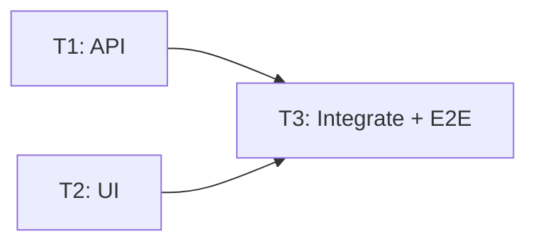

# Multi-Agent Qwen Code Orchestrator — Yêu cầu hệ thống (MVP)

**Phiên bản:** 1.0 — Bản yêu cầu thống nhất  
**Mục tiêu:** Xây dựng tầng điều phối nhiều Qwen Code tự chủ bằng LangGraph Agent Server (`langgraph dev`), vận hành hoàn toàn trong **một Docker container**, hỗ trợ giao việc động, thực thi song song theo DAG, giao tiếp với con người và theo dõi tiến độ.

## 1. Nguyên tắc và phạm vi đã chốt

1. Hệ thống gồm **6 loại agent** đánh số **0–5**: Communicator, Analyze, Plan & Delegate, Execute, Verify & Integrate, Finalize.
2. **Chỉ một container** chứa toàn bộ runtime: `langgraph dev`, Task Dispatcher, các agent worker, Qwen Code CLI, Git và giao diện quản lý cơ bản. **Không triển khai backend nghiệp vụ/API điều phối độc lập, PostgreSQL hoặc Redis riêng**.
3. Task Dispatcher là **single-writer cho task chính thức**: nhận đề xuất từ agent, kiểm tra quyền/quy tắc/trạng thái/dependencies/giới hạn, sau đó ghi hoặc cập nhật task trong **LangGraph Store**. Nó là process Python nội bộ, không phải web backend.
4. Mỗi loại agent có **worker process độc lập**; riêng Execute có **tối đa 5 worker**. Supervisor dùng multiprocessing.Process và Queue. Dispatcher claim task, dựng context rồi gửi snapshot vào queue worker. Worker chờ queue.get(), invoke graph ngay trong process của mình và gửi kết quả qua queue chung; không đọc Store và không gọi LangGraph SDK.
5. **Agents không nối bằng một LangGraph edge cố định.** Các graph có thể tạo đề xuất giao việc cho nhau; Dispatcher kiểm tra và mở task thích hợp trong Store.
6. **Mọi lượt xử lý task dùng đúng một định dạng structured output chung: `TaskGraphOutput`**. Năm agent kỹ thuật sử dụng Qwen Code. Communicator đọc trực tiếp `messages` và gọi ChatOpenAI với prompt riêng hướng người dùng; không chạy Qwen Code. Chat trực tiếp không cần task/cwd và trả `AIMessage`.
7. Phân biệt **dữ liệu shared** (mọi agent được thấy) và **dữ liệu private** (chỉ graph/agent/worker sở hữu và Dispatcher được phép đọc theo chính sách). Không đưa toàn bộ private data vào prompt hoặc context dùng chung.
8. Trạng thái task chỉ gồm: **`TODO`, `DOING`, `IN_REVIEW`, `DONE`, `CLOSED`**. `IN_REVIEW` chỉ dành cho Verify & Integrate; chỉ Finalize được quyền **yêu cầu** đóng task (`CLOSED`); Dispatcher là bên thực hiện cập nhật trong Store.
9. **Giao việc ngược tối đa 3 lần trên một execution chain**, tính cả các lần rework/replan; nếu vượt giới hạn, chuyển việc cần quyết định cho Communicator/human. Retry kỹ thuật có bộ đếm riêng.
10. Mỗi Execute worker sở hữu **Git worktree riêng cho từng project**, tách khỏi worktree tích hợp của Verify & Integrate.
11. Qwen Code kết nối đến **LLM qua base URL nội bộ, API key và model có thể cấu hình**; mục tiêu hỗ trợ môi trường nội bộ không cần Internet khi đã có đủ image/dependencies/models.

## 2. Thành phần và trách nhiệm

| Thành phần | Vai trò | Qwen Code |
|---|---|---|
| **0 — Communicator** | Đọc messages, gọi ChatOpenAI trực tiếp; đại diện người dùng, làm rõ mục tiêu/phạm vi; đề xuất task cho chính nó, human hoặc Analyze qua Dispatcher | Không |
| **1 — Analyze** | Phân tích yêu cầu, khám phá codebase, độ phức tạp, tiêu chí nghiệm thu; nếu đủ rõ chuyển Plan, nếu không yêu cầu Communicator hỏi người | Có |
| **2 — Plan & Delegate** | Lập kế hoạch tự nhiên rồi chuyển thành **Task DAG**, chia task và dependencies, phân biệt task song song/task phải chờ, đề xuất agent thực hiện | Có |
| **3 — Execute** | Nhiều Qwen Code session độc lập; tự explore/code/test/fix; có thể đề xuất task mới về Analyze/Plan hoặc chuyển Verify | Có |
| **4 — Verify & Integrate** | Review, test, xử lý xung đột, tích hợp Git commits/branches; đạt thì chuyển Finalize, không đạt trả Execute | Có |
| **5 — Finalize** | Kiểm tra nghiệm thu tổng thể, tổng hợp artifact/report, yêu cầu Dispatcher chuyển các task hợp lệ sang CLOSED, phát sự kiện hoàn tất cho Communicator | Có |
| **Task Dispatcher** | Duy nhất kiểm tra/claim/schedule/ghi task chính thức, xử lý kết quả, idempotency, rework budget và recovery | Không |
| **Workspace Manager** | Quản lý repository, per-worker worktree, integration worktree, commit, branch và cleanup | Không |
| **Supervisor** | Khởi động, kiểm tra health và dừng các process trong một container | Không |
| **Web Dashboard** | Chat/approval, tiến độ, Task DAG, trạng thái worker, event/log, Git diff/artifact | Không |

**Luồng tổng quát:** `Human ↔ Communicator → Analyze → Plan & Delegate → Execute (song song có điều kiện) → Verify & Integrate → Finalize → Communicator → Human`. Các chuyển hướng ngược phải thông qua Task Dispatcher, không có hard-code thành cạnh LangGraph giữa các graph.

## 3. Vòng đời xử lý trong mỗi agent

Đối với **Agent kỹ thuật 1–5**, mỗi lượt xử lý task có hai pass:

1. **Pass 1 — Work:** chạy Qwen Code để thực hiện nhiệm vụ chuyên biệt. Plan tạo kế hoạch **bằng ngôn ngữ tự nhiên**; Execute viết/chạy code; Verify thực hiện review/kiểm tra; v.v. Ghi log, kết quả và references đến artifacts.
2. **Pass 2 — Graph decision:** gọi LangChain `ChatOpenAI.ainvoke()` bất đồng bộ, tắt streaming (`streaming=False`, `disable_streaming=True`, tag `nostream`), để đọc kết quả Pass 1 và sinh **chỉ một `TaskGraphOutput` hợp lệ theo JSON Schema chung**; kể cả không có task mới, vẫn trả graph rỗng cùng outcome và source-task result.
3. Worker gửi output vào multiprocessing.Queue chung. Dispatcher kiểm tra protocol, quyền, dependencies, transitions, backward budget và idempotency rồi mới ghi graph/task chính thức.
4. Dispatcher là process ứng dụng duy nhất có Store client. Các agent nhận context đã chuẩn bị qua queue và không tự cập nhật trạng thái task.

Dispatcher cấp task cho worker đang rảnh sau khi kiểm tra readiness và capacity.
Graph xử lý một lượt rồi kết thúc; worker tiếp tục queue.get() đến sentinel shutdown.
Lease/attempt phục vụ retry; task còn lưu trong Store, queue chỉ nằm trong RAM.
Phần Communicator đọc tiến độ hoặc hủy task được hoãn; chưa thêm CANCEL.


Communicator gọi ChatOpenAI trực tiếp với prompt riêng và lịch sử `messages`. Chat trực tiếp chỉ cần messages; task Communicator do Dashboard/Dispatcher cấp trả `TaskGraphOutput` sau một lần gọi LLM. API tạo request intake, Dispatcher mở task Communicator. Agent chọn tự giao, hỏi human hoặc giao Analyze; người dùng không cần tương tác trực tiếp với Store. Các worker kỹ thuật chạy nền chờ queue, không chạy nối tiếp ngay trong một lượt chat.

Các Qwen Code Work session stream log private; lượt Decision dùng Chat Completions JSON Schema, không gọi CLI hoặc stream token. Cấu hình endpoint/model/API key nội bộ riêng bằng `DECISION_BASE_URL`, `DECISION_MODEL`, `DECISION_API_KEY`; từng biến bỏ trống kế thừa `QWEN_*` tương ứng. Timeout qua `DECISION_TIMEOUT_SECONDS` (mặc định 120 giây). Runtime vẫn kiểm tra schema, danh tính source và hướng giao task trước khi gửi Dispatcher.

## 4. Một protocol structured output duy nhất: `TaskGraphOutput`

**Tất cả agent sử dụng cùng một kiểu output graph**; không tạo các kiểu output riêng `AnalyzeOutput`, `PlanOutput`, `ExecuteOutput` hay `AgentDecision`. Khác nhau chỉ ở số lượng node, `target_agent`, `node_type`, `outcome` và các cạnh.

### 4.1. Cấu trúc chuẩn

```json
{
  "schema_version": "1.0",
  "project_id": "project-001",
  "source_task_id": "task-plan-001",
  "producer_agent": "PLAN_DELEGATE",
  "execution_chain_id": "chain-001",
  "summary": "Build authentication feature",
  "source_result": {
    "outcome": "SUCCESS",
    "proposed_status": "DONE",
    "artifact_refs": ["artifact://plans/auth-plan.md"]
  },
  "nodes": [
    {
      "id": "api",
      "node_type": "TASK",
      "target_agent": "EXECUTE",
      "title": "Implement authentication API",
      "description": "Implement endpoints and tests",
      "acceptance_criteria": ["Unit tests pass"],
      "priority": 2,
      "context_refs": ["shared://contracts/auth-v1"],
      "artifact_refs": []
    },
    {
      "id": "ui",
      "node_type": "TASK",
      "target_agent": "EXECUTE",
      "title": "Implement login UI",
      "description": "Use shared authentication API contract",
      "acceptance_criteria": ["UI tests pass"],
      "priority": 2,
      "context_refs": ["shared://contracts/auth-v1"],
      "artifact_refs": []
    },
    {
      "id": "integrate",
      "node_type": "TASK",
      "target_agent": "VERIFY_INTEGRATE",
      "title": "Merge and verify API + UI",
      "description": "Integrate both commits and run E2E tests",
      "acceptance_criteria": ["Merged build and E2E tests pass"],
      "priority": 2,
      "context_refs": [],
      "artifact_refs": []
    }
  ],
  "edges": [
    {"from": "api", "to": "integrate", "type": "DEPENDS_ON", "condition": "SUCCESS"},
    {"from": "ui", "to": "integrate", "type": "DEPENDS_ON", "condition": "SUCCESS"}
  ],
  "human_request": null,
  "shared_updates": [],
  "private_updates": [],
  "notification": null
}
```

**Quy ước:** `from → to` nghĩa là **`to` phải đợi `from`**. `id` trong `nodes` là ID cục bộ của đề xuất; Dispatcher cấp `task_id` chính thức và map toàn bộ cạnh. `source_result` là outcome của task nguồn, không phải quyền cập nhật Store. `shared_updates` và `private_updates` chỉ là đề xuất có kiểm tra scope; các bản ghi lớn phải dùng artifact reference.

`node_type` tối thiểu gồm `TASK`, `HUMAN_APPROVAL`, `NOTIFICATION`. Node không phải `TASK` không được tính vào dependency DAG của công việc lập trình. `human_request` và `notification` là metadata của **cùng một protocol graph**, không phải một schema output khác. Communicator chọn đúng một hành động: một TASK cho chính nó/Analyze hoặc một human_request/HUMAN_APPROVAL. Notification có thể đi kèm để giải thích giả định. Mọi producer đều tuân theo một JSON Schema duy nhất.

### 4.2. Plan & Delegate: DAG và thực thi song song

**Bắt buộc:** Planner phải mô tả rõ quan hệ phụ thuộc. Ví dụ `T1` và `T2` độc lập, `T3` chỉ được mở khi **cả T1 và T2** đáp ứng điều kiện đầu ra:



- Dispatcher có thể claim và chạy `T1`, `T2` **đồng thời** khi đủ slot worker.
- `T3` được lưu `TODO` ngay từ đầu nhưng **chưa ready**: Dispatcher không claim nó cho đến khi **tất cả** predecessors thỏa điều kiện (`ALL` join; không chỉ một predecessor xong).
- Task `TODO` nhưng chưa đủ dependency **không** được chạy; `ready` là giá trị tính từ DAG, không thêm status thứ sáu.
- Các predecessor phải có outcome đạt yêu cầu (`SUCCESS`/đã chấp nhận theo edge policy), không chỉ có status `DONE` nếu outcome là lỗi hoặc yêu cầu sửa.
- Nếu T3 cần mã nguồn do T1/T2 tạo, phải có **integration barrier** trước khi T3 bắt đầu; T3 dùng code đã merge, không tự thấy thay đổi chưa merge trong worktree khác.
- Planner cần định nghĩa contract dùng chung khi tách task song song (API/schema/file ownership) để giảm conflict.
- Dispatcher kiểm tra: node ID duy nhất; target hợp lệ; cạnh hợp lệ; không self-loop; **không có cycle**; dependencies được resolve; không vượt concurrency/resource budget; DAG không chứa dependency vào task không tồn tại, trừ task đã được phép tham chiếu bằng ID chính thức.
- Plan được version hóa (`plan_id`, `plan_version`); replan sinh phiên bản mới/sửa phần chưa chạy qua Dispatcher, không âm thầm phá dependencies của task đang `DOING`.

### 4.3. Delegation và Rework

Graph của Execute có thể đề xuất node gửi `ANALYZE` (thiếu yêu cầu), `PLAN_DELEGATE` (cần chia lại việc) hoặc `VERIFY_INTEGRATE` (đã xong). Graph của Verify có thể đề xuất node `EXECUTE` để sửa lỗi. Graph của Finalize có thể đề xuất rework nếu nghiệm thu cuối không đạt. Mọi yêu cầu được ghi rõ `reason`, liên kết với `source_task_id`, và được Dispatcher tính backward budget.

**Không dùng việc đổi task cũ từ `DONE` về `TODO` để biểu diễn rework**: tạo task mới với `parent_task_id`, `root_task_id`, `execution_chain_id` và `caused_by_task_id` để bảo toàn lịch sử.

## 5. LangGraph Store: Shared vs Private

Store là nguồn dữ liệu **do Dispatcher quản lý**; agent nhận snapshot context qua queue; checkpoint/thread state lưu trạng thái một lần chạy hoặc một phiên graph và không thay thế Store. Dữ liệu lưu theo `project_id`, `agent_type`, `thread_id`, `worker_id` khi phù hợp.

### 5.1. Namespace gợi ý

```text
("coding", project_id, "shared", "context")      # Requirements, contracts, decisions
("coding", project_id, "shared", "artifacts")    # References, metadata; không nhét blob lớn
("coding", project_id, "tasks")                  # Authoritative tasks: chỉ Dispatcher ghi
("coding", project_id, "plans")                  # Versioned Task DAG: chỉ Dispatcher ghi
("coding", project_id, "events")                 # Audit/observability: Dispatcher ghi
("coding", project_id, "responses", agent_type)  # Internal idempotency receipts, Dispatcher only
("coding", project_id, "approvals")              # Human requests/decisions
("coding", project_id, "private", agent_type, thread_id)
("coding", project_id, "private", "execute", worker_id, thread_id)
```

### 5.2. Chính sách nhìn thấy dữ liệu

| Loại dữ liệu | Communicator | Analyze/Plan/Execute/Verify/Finalize | Dispatcher |
|---|---|---|---|
| Shared context/requirements/contracts | Snapshot được cấp | Snapshot được cấp | Đọc/ghi có kiểm soát |
| Task DAG, status, progress, event chung | Snapshot được cấp | Snapshot được cấp | Đọc/ghi |
| Private graph state, prompt/scratchpad, raw logs riêng | Không mặc định | Chỉ graph/worker chủ sở hữu | Đọc khi cần validation/recovery |
| Approval và phản hồi người dùng | Đọc/ghi yêu cầu theo chính sách | Chỉ bản tóm tắt liên quan | Điều phối và audit |
| Qwen API key/secrets | Không | Không đưa vào LLM context | Chỉ runtime/config cần thiết |

Các agent nhận **shared context + private context của chính mình + tài liệu đầu vào được phép theo task**. Khi cần chuyển tri thức từ private sang shared, agent đề xuất một `shared_update` được kiểm tra trước khi công bố. Communicator có thể đọc toàn bộ **tiến độ công khai**, không tự động được quyền đọc scratchpad của các graph.

**Giới hạn bảo mật cần ghi rõ:** namespace của LangGraph Store là phân vùng logic, **không tự là cơ chế ACL/cách ly an toàn** khi các process có cùng thông tin xác thực Store. Việc ngăn agent đọc private của nhau được thực hiện bằng scoped store adapter, chỉ cấp context/tool đã lọc, không đưa Store SDK hay credentials đầy đủ cho Qwen Code. Với code không tin cậy được Qwen thực thi, một container/worktree riêng không đảm bảo sandbox bảo mật tuyệt đối.

## 6. Task model và lifecycle

Mỗi task chính thức tối thiểu chứa:

```json
{
  "task_id": "task-010",
  "project_id": "project-001",
  "plan_id": "plan-001",
  "plan_version": 1,
  "agent": "EXECUTE",
  "parent_task_id": "task-003",
  "root_task_id": "task-001",
  "execution_chain_id": "chain-001",
  "depends_on": ["task-007", "task-008"],
  "status": "TODO",
  "outcome": null,
  "priority": 2,
  "attempt": 0,
  "max_attempts": 3,
  "backward_count": 0,
  "assigned_worker": null,
  "lease_expires_at": null,
  "qwen_session_id": null,
  "worktree_path": null,
  "base_commit": null,
  "result_refs": [],
  "version": 1
}
```

**State machine:**

- `TODO → DOING`: Dispatcher claim khi toàn bộ dependency đã đạt và còn worker/slot.
- `DOING → DONE`: agent xử lý xong và Dispatcher ghi kết quả; `outcome` có thể là `SUCCESS`, `NEED_ANALYSIS`, `NEED_REPLAN`, `CHANGES_REQUESTED` hoặc `FAILED`. `DONE` **không đồng nghĩa** được nghiệm thu.
- Chỉ task của **Verify & Integrate** được vào `IN_REVIEW` (`DOING → IN_REVIEW → DONE`).
- `DONE → CLOSED`: **chỉ khi Finalize đề xuất hợp lệ**; Dispatcher kiểm tra acceptance và ghi đóng task. Task Finalize cũng được đóng trong cùng bước kết sổ hợp lệ.
- Task `CLOSED` bất biến về nghiệp vụ; muốn sửa tiếp tạo task/plan mới, không mở lại ID cũ.
- Agent bị lỗi/crash: giữ `DOING` cho đến khi lease hết; Dispatcher phục hồi/ghi sự kiện và đưa task hợp lệ về `TODO` theo retry policy (không phải backward delegation).
- Với task chờ người, tạo **approval record** riêng, không bổ sung status `WAITING` và không giữ một worker bận đợi người dùng.

**Backward delegation:** tăng `backward_count` của `execution_chain_id` khi đi ngược luồng, ví dụ Execute→Analyze, Execute→Plan, Verify→Execute, Finalize→Verify. Communicator tự giao hoặc hỏi human cũng tăng cùng backward_count; không có bộ đếm hỏi riêng. Trả lời/timeout giữ nguyên chain và budget. Khi hết ngân sách, Communicator phải giao Analyze với giả định nêu rõ, không hỏi tiếp. Nếu lượt thứ tư được đề xuất, Dispatcher từ chối tự động và sinh yêu cầu human intervention; chỉ sau quyết định của con người mới lập kế hoạch xử lý tiếp. Retry kỹ thuật tối đa 3 lần/task tính riêng.

## 7. Dispatcher: tiếp nhận, xác thực, lập lịch và phục hồi

1. Đọc multiprocessing.Queue chung, khử trùng lặp theo request_id và xác thực producer/source task/attempt.
2. Validate **một `TaskGraphOutput` duy nhất**, trạng thái cho phép, định dạng node/edge, visibility, quyền và giới hạn backward.
3. Với Task DAG: kiểm tra cycle, dependency, predecessor outcomes, điều kiện ALL-join, replan/versioning và điều kiện artifacts đã được merge khi cần.
4. Ghi task/plan/event chính thức vào Store; tạo receipt accepted/rejected kèm lý do vào `responses`.
5. Chọn task TODO đủ dependency, claim cho worker rảnh và cập nhật DOING/owner/lease/attempt; dựng context rồi đưa snapshot vào queue worker.
6. Worker invoke graph local, gửi heartbeat/progress metadata và output graph qua queue chung khi hoàn thành.
7. Reconcile task `DOING` bị orphan, Qwen subprocess bị chết, run thất bại, worktree còn dang dở; cleanup an toàn sau khi giữ artifacts.

**Nguyên tắc single-writer:** worker chỉ gửi message qua queue; chỉ Dispatcher có Store client và ghi dữ liệu chính thức. `request_id` và task IDs do Dispatcher cấp/derive phải idempotent. Store `put/get/search` không được coi là transaction nhiều bản ghi/atomic CAS; Dispatcher phải có nhật ký thao tác có thể replay/reconcile, ghi receipt chỉ sau khi task/graph authoritative đã được áp dụng. Một Dispatcher process duy nhất ngăn tranh chấp claim trong MVP; không tự nhận đạt bảo đảm exactly-once trên mọi crash.

**Scheduling:** tối đa 5 phiên Qwen Code chạy **trên toàn hệ thống** tại một thời điểm. Số worker Execute cấu hình 1–5; Analyze/Plan/Verify/Finalize cũng sử dụng các slot Qwen này khi hoạt động. Communicator gọi ChatOpenAI trực tiếp và không chiếm slot Qwen. Giới hạn concurrency của `langgraph dev` phải đủ để không khiến các graph run bị tuần tự ngoài ý muốn. Dùng `asyncio.create_subprocess_exec` (hoặc tương đương) để không block event loop của server.

## 8. Git repository, worktree và tích hợp

```text
/workspace/
  repositories/<project_id>/
  worktrees/<project_id>/execute-01/
  worktrees/<project_id>/execute-02/
  worktrees/<project_id>/execute-03/
  worktrees/<project_id>/execute-04/
  worktrees/<project_id>/execute-05/
  worktrees/<project_id>/integration/
  artifacts/<project_id>/logs|reports|patches/
```

- Một Execute worker chỉ chạy Qwen Code trong worktree đã được cấp; worktree không được dùng đồng thời bởi hai task.
- Mỗi task lưu `base_commit`, `branch`, `commit_sha`, `worktree_path` và tham chiếu đến diff/log. Kết quả phải được commit hoặc lưu patch an toàn trước khi worker được giải phóng.
- Verify & Integrate có worktree integration riêng; cherry-pick/merge commits theo dependency, xử lý conflict, chạy integration/E2E tests và ghi trạng thái nghiệm thu.
- Khi task sau phụ thuộc code từ nhiều task trước, Dispatcher phải đảm bảo các thay đổi đã tích hợp vào baseline phù hợp trước khi mở task sau.
- Không tự động force-push hoặc hủy worktree có uncommitted changes. Git conflict phải trở thành kết quả Verify/rework có thể quan sát.
- Giới hạn file chỉnh sửa hoặc module ownership trong plan khi có thể để giảm đụng độ giữa các Execute worker.

## 9. Communicator và giao diện quản lý

Communicator sử dụng ChatOpenAI trực tiếp với prompt riêng và lịch sử messages, đứng về phía người dùng, làm rõ mục tiêu và không cần hiểu chi tiết kỹ thuật. Nó có thể giao cho chính nó, human hoặc Analyze qua đề xuất task cho Dispatcher. Hỏi human dùng approval có deadline 30 phút mặc định (`HUMAN_RESPONSE_TIMEOUT_SECONDS`); hết hạn chuyển TIMED_OUT và tiếp tục cùng chain với giả định được thông báo rõ, không coi là phê duyệt. State có messages là list[AnyMessage] dùng add_messages; chỉ Communicator, Analyze và Finalize được cấp lịch sử hội thoại. Các agent còn lại chỉ nhận bản tóm tắt yêu cầu. Khi Finalize xong, phát **notification event** cho Communicator; không tạo một task cuối cùng mà không ai có quyền đóng.

**Web Dashboard tối thiểu** (trong cùng container, không yêu cầu custom orchestration backend): danh sách project/session; chat/approval; màn hình Task DAG tương tác; hiển thị task statuses, dependency blockers, retry/backward counters; trạng thái 5 Execute workers/worktrees; streaming logs; Git commits/diff; event timeline; kết quả review và báo cáo Finalize. Frontend giao tiếp với Agent Server/Store API theo phương án triển khai phù hợp trong mạng nội bộ; không tạo thêm service backend nghiệp vụ. Cần kiểm tra cơ chế xác thực/CORS và không để trình duyệt có quyền ghi trực tiếp namespace authoritative task.

## 10. Đóng gói và cấu hình

**Chỉ một image/container** bao gồm Python, Node/Qwen Code, Git, LangGraph CLI, mã nguồn graph/Dispatcher/workers, frontend build và Supervisor. Supervisor là PID 1 hoặc dùng init nhẹ, khởi động `langgraph dev --host 0.0.0.0 --port 2024 --no-browser --no-reload`, đợi readiness rồi mở Dispatcher và workers; chuyển SIGTERM đúng cách và tự khởi động lại worker chết theo chính sách.

Biến môi trường gợi ý:

```dotenv
LANGGRAPH_URL=http://127.0.0.1:2024
QWEN_BASE_URL=http://llm.internal/v1
QWEN_API_KEY=change-me
QWEN_MODEL=qwen-coder
DECISION_BASE_URL=
DECISION_API_KEY=
DECISION_MODEL=
DECISION_TIMEOUT_SECONDS=120
MAX_EXECUTE_WORKERS=5
MAX_QWEN_SESSIONS=5
MAX_BACKWARD_DELEGATIONS=3
MAX_TECHNICAL_RETRIES=3
DISPATCH_POLL_SECONDS=2
TASK_LEASE_SECONDS=600
WORKSPACE_ROOT=/workspace
DATA_ROOT=/data
```

Cấu hình kết nối Qwen Code phải map đúng biến/config provider mà **phiên bản Qwen Code được pin** yêu cầu; các biến `QWEN_*` trên là interface của Orchestrator, không mặc định là biến CLI hỗ trợ trực tiếp. Mount volumes cho `/workspace` và dữ liệu phát sinh tại `/data`; không chép API key vào prompt, logs hoặc repository. Không có phụ thuộc Internet lúc chạy khi base image/packages/models đã sẵn sàng. `langgraph dev` là chế độ phát triển; cần kiểm thử riêng khả năng persist/restore của Store và checkpoints với phiên bản được pin, không hứa production durability chỉ vì có volume.

## 11. Cấu trúc mã nguồn gợi ý

```text
multi-agent-qwen-orchestrator/
├── Dockerfile
├── docker-compose.yml
├── langgraph.json
├── pyproject.toml
├── .env.example
├── src/
│   ├── graphs/
│   │   ├── communicator.py
│   │   ├── analyze.py
│   │   ├── plan_delegate.py
│   │   ├── execute.py
│   │   ├── verify_integrate.py
│   │   └── finalize.py
│   ├── dispatcher/
│   │   ├── main.py
│   │   ├── validator.py
│   │   ├── dag_scheduler.py
│   │   ├── transitions.py
│   │   └── recovery.py
│   ├── workers/
│   │   ├── main.py
│   │   ├── polling.py
│   │   └── graph_runner.py
│   ├── runtime/
│   │   ├── qwen.py
│   │   ├── worktree.py
│   │   └── context_scope.py
│   ├── schemas/
│   │   ├── task_graph.py
│   │   ├── task.py
│   │   └── store_records.py
│   └── supervisor.py
├── prompts/
│   ├── analyze.md
│   ├── plan_delegate.md
│   ├── execute.md
│   ├── verify_integrate.md
│   └── finalize.md
└── dashboard/
```

`langgraph.json` chỉ expose graph `communicator`; graph kỹ thuật chạy local trong worker process với context do Dispatcher cấp. Agent workers, Dispatcher và Supervisor là Python processes/threads nội bộ cùng container. Không cần `PostgreSQL URL`, Redis hay một task-queue service bên ngoài trong MVP.

## 12. Điều kiện nghiệm thu MVP

- [ ] Chạy một Docker container, một `langgraph dev` và toàn bộ workers/Dispatcher; truy cập được Dashboard trong mạng nội bộ.
- [ ] User → Communicator → Analyze → Plan chạy được end-to-end, gồm cả tình huống phải xin xác nhận.
- [ ] Agent kỹ thuật 1–5 thực hiện Pass 1 Qwen Code + Pass 2 `TaskGraphOutput`; Communicator đọc messages, gọi ChatOpenAI trực tiếp và dùng cùng budget backward khi tự giao/hỏi human.
- [ ] Planner sinh **DAG đúng**: T1 và T2 chạy song song; T3 giữ `TODO` đến khi **cả hai** predecessor thành công và artifacts/code prerequisites đã sẵn sàng.
- [ ] Dispatcher từ chối graph có cycle, dependency sai, target không hợp lệ, transition trái phép và trùng `request_id`.
- [ ] Hai workers không claim cùng một task; tối đa 5 Qwen Code session toàn hệ thống.
- [ ] Shared data đọc được từ mọi agent, private context của graph A không xuất hiện trong context của graph B hay Communicator; shared promotion phải qua policy.
- [ ] Execute worker có worktree riêng; thay đổi được review/merge/test trước khi hoàn tất; downstream nhận baseline đã tích hợp nếu phụ thuộc code.
- [ ] `IN_REVIEW` chỉ cho Verify; `CLOSED` chỉ được tạo bởi hành động hợp lệ từ Finalize qua Dispatcher.
- [ ] Giao việc ngược lần 1–3 được phép, lần 4 bị chặn và chuyển human; retry crash không tính vào backward count.
- [ ] Dispatcher phục hồi được task orphan trong giới hạn MVP, không tạo task trùng khi replay cùng request.
- [ ] Dashboard hiện Task DAG, progress, blocking reasons, Qwen streaming log, approve/reject, review, commits và final report.
- [ ] Có test restart container, khôi phục worktrees/artifacts và nêu rõ mức bảo đảm persistence thực tế của `langgraph dev` đã pin.

## 13. Tài liệu tham khảo kỹ thuật

- LangGraph Store: https://github.com/langchain-ai/docs/blob/main/src/oss/langgraph/stores.mdx
- LangGraph persistence/checkpoint: https://github.com/langchain-ai/docs/blob/main/src/oss/langgraph/persistence.mdx
- LangGraph SDK Store Client: https://reference.langchain.com/python/langgraph-sdk/_async/store
- LangGraph CLI/dev: https://github.com/langchain-ai/langgraph/blob/main/libs/cli/README.md
- Qwen Code headless: https://qwenlm.github.io/qwen-code-docs/en/users/features/headless/
- Qwen Code structured output: https://github.com/QwenLM/qwen-code/blob/main/docs/users/features/structured-output.md
